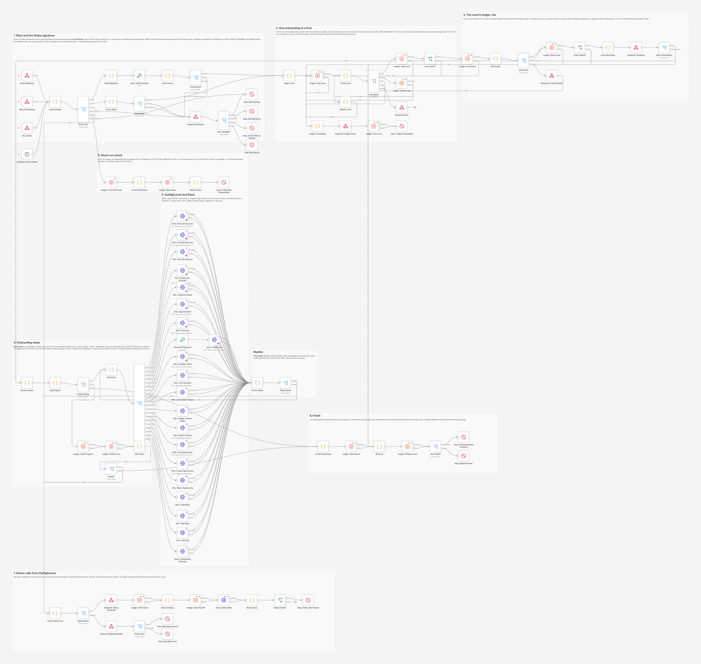
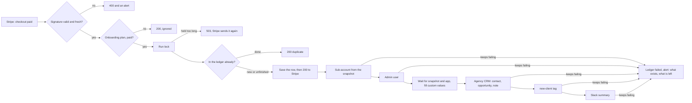
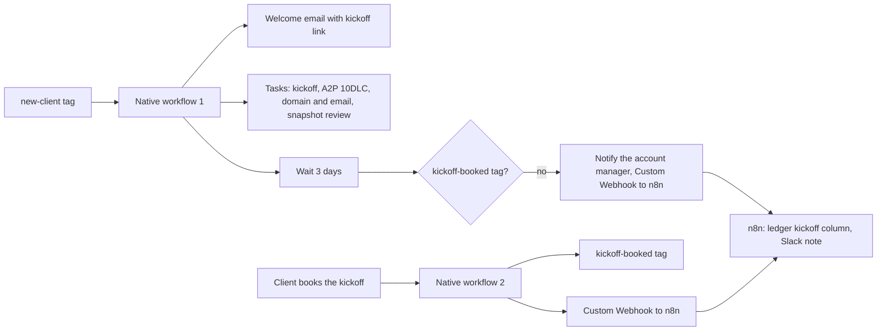

# GoHighLevel Agency Client Onboarding: Stripe, n8n and native GHL Workflows

When a client pays for an onboarding plan through Stripe, n8n creates their GoHighLevel sub-account from the plan's snapshot, adds their admin user, fills in the sub-account's custom values and adds them to the agency's own CRM. From there, native GoHighLevel workflows send the welcome email, create the team's tasks and chase the kickoff call. Built with n8n and GoHighLevel workflows.



## The problem

A GoHighLevel agency onboards every new client the same way, by hand: create the sub-account, load the right snapshot, add the client's login, type the business name, phone, address and booking link into a dozen custom values, add the client to the agency's own pipeline, send the welcome email, and remember A2P registration and the email domain. It can take an hour per client, and steps get missed. A simple Zap is not much better: when a call fails halfway it leaves a half built account behind, and when Stripe delivers the payment event twice it builds two. What the agency wants is the whole checklist done the moment the payment lands, exactly once, with a clear message when something needs a person.

## What this does

1. **Takes the payment from Stripe.** Stripe's `checkout.session.completed` (and `checkout.session.async_payment_succeeded` for delayed payment methods) arrives at an n8n webhook. The `Stripe-Signature` header is checked over the raw body: HMAC SHA-256 of the timestamp and the body, every `v1` signature compared in constant time, and a 5 minute tolerance against replays. Only paid checkouts with an onboarding plan in their metadata go on; everything else gets a 200 at once, so Stripe does not send it again.
2. **Records it before answering.** The event goes into a ledger (an n8n data table, one row per Stripe event) and only then does Stripe get its 200. A repeated event, or a second event for the same Checkout Session, is answered as a duplicate and does nothing. A run lock keeps two onboardings from running at the same time.
3. **Creates the sub-account from the right snapshot** through HighLevel's agency API (`PLAN_SNAPSHOTS` maps each plan to a snapshot), after checking that it does not exist yet. This API needs the Agency Pro plan (see Setup).
4. **Creates the client's admin user** on that sub-account, after checking that the email is not a HighLevel user already. The password is random and never stored; the client sets their own.
5. **Fills the custom values by name.** It waits until the snapshot has finished loading and the agency app is installed on the new sub-account, gets a token for it, finds the twelve custom values it owns by name (business name, phone, email, address, website, owner, booking link) and writes the client's details. The booking link comes from the snapshot's booking calendar. When HighLevel's snapshot status has no record of the load, it waits for the custom values to appear instead.
6. **Adds the client to the agency's own sub-account:** the contact, an opportunity in the `Onboarding` stage of the onboarding pipeline, a note with the plan and the sub-account link, and finally the `new-client` tag, which starts the native onboarding workflow.
7. **Posts a Slack summary** with links to the sub-account and the contact.
8. **Hands over to native GoHighLevel workflows** in the agency sub-account: a welcome email with the kickoff booking link, four tasks for the account manager (kickoff call, A2P 10DLC, domain and email, snapshot review), and a reminder to the team when the kickoff is not booked after 3 days. When the client books, a second workflow tags them and tells n8n, which updates the ledger and Slack.
9. **Is safe to stop halfway.** Each finished step is saved in the ledger with the IDs it created. A step that keeps failing ends the run with an alert that says exactly what exists and what is left, and the Retry webhook continues from there without creating a second sub-account or user.
10. **Fails loudly.** Every run that leaves something open and every refused call ends as a failed run, and the error workflow posts the reason to Slack. A scheduled check reports onboardings that an n8n restart cut off.

## What runs where

| Part | Runs in | Why |
|---|---|---|
| Signature check, ledger, run lock, retries | n8n | Needs state, code and exact control over what Stripe hears |
| Sub-account, user, custom values | n8n, through HighLevel's API (agency OAuth app) | Agency level work that a sub-account workflow cannot do |
| Contact, opportunity, note, tag in the agency sub-account | n8n, through HighLevel's API (Private Integration token) | So everything happens in the right order and only once |
| Welcome email, tasks, kickoff reminder, kickoff booked | Native GoHighLevel workflows in the agency sub-account, built by hand from [ghl/native-workflows.md](ghl/native-workflows.md) | The agency's team edits emails and tasks in GoHighLevel, where they live, without touching n8n |
| What every client snapshot must contain | [ghl/snapshot-checklist.md](ghl/snapshot-checklist.md) | Custom values, calendars and the rest the workflow relies on |

## How it works

From payment to provisioned client:



Every create is preceded by a lookup, and every finished step is saved in the ledger before the next one starts.

After the tag, in GoHighLevel and back:



**Why nothing is created twice.** Four things guard it. The ledger has one row per Stripe event and refuses a second event for the same Checkout Session. The run lock lets only one onboarding run at a time, so a duplicate delivery that arrives during the first run waits; it either finds the onboarding done or gets a 503, and Stripe's later resend finds it done. Every create is preceded by a lookup (the sub-account by the client's email and name, the user by email, the opportunity by contact and pipeline, the note by an event marker in its text), so a retry adopts what an earlier run made. A sub-account is only adopted when both the name and the email match: one that only shares the name may belong to another client, and adopting it would put this client's login and details into someone else's account. And when HighLevel never answered a sub-account create and the lookups find nothing certain, the workflow does not guess: it asks a person to check (naming any sub-account with the same name), and the retry takes the found sub-account's ID or an explicit "create it", which covers one create.

**Why Stripe never waits for HighLevel.** The 200 goes out as soon as the event is safely in the ledger. Provisioning runs after that, and a failure from then on is the workflow's to finish (alert, retry), not Stripe's to resend. Before that point, a failure (settings, ledger) answers 500, so Stripe tries again later.

## Workflow at a glance

| Step | Nodes | What it does |
|---|---|---|
| 1 | Stripe Webhook, Retry Onboarding, GHL Status, Schedule: Stuck Check, Load Settings, Route Call | Every entry point starts at **Load Settings**, which checks every setting once and routes the call |
| 2 | Read Signature, Sign: Stripe Payload, Check Event, Event Route | Reads the raw body and the `Stripe-Signature` header, computes the HMAC (Crypto node), compares every `v1` in constant time, checks the tolerance, then reads the Checkout Session: plan, payment status, the client's details |
| 3 | Check Retry, Retry Route | The Retry webhook: `X-Run-Secret` header and `{"eventId": "evt_..."}` |
| 4 | Respond: Refused, Alert Needed?, Stop: Bad Settings, Stop: Bad Signature, Stop: Event Without Session, Stop: Bad Secret | Answers refused and ignored calls; the refusals end as failed runs for an alert |
| 5 | Begin Lock, Ledger: Find Lock, Check Lock, Lock Route, Ledger: Take Lock, Lock Taken?, Ledger: Create Lock, Wait for Lock, Respond: Busy | The run lock: one conditional update; a second run waits up to `LOCK_WAIT_SECONDS`, then Stripe gets 503. A lock row that can never be taken ends with 500 and an alert instead of a run that waits forever |
| 6 | Ledger Unavailable, Respond: Ledger Down, Ledger: Free Lock, Stop: Ledger Unavailable | When the ledger cannot be used before anything is created: 500 to Stripe and an alert |
| 7 | Ledger: Find Event, Plan Event, Event Plan, Ledger: Save Event, Event Saved?, Event Recorded, Respond: Accepted, Start Onboarding?, Respond: Event Handled | One row per event: duplicates, retries of unfinished events, unknown plans (held for a person). The row is saved before Stripe gets its 200 |
| 8 | Prepare Steps, Step Engine, Engine Route, Build Call, Call Type | The step engine: decides the next call of the current step, or saves a finished step, or finishes |
| 9 | GHL: Find Sub-Account, GHL: List Sub-Accounts, GHL: Get Sub-Account, GHL: Create Sub-Account, GHL: Snapshot Status, GHL: App Installed?, GHL: Find User, Generate Password, GHL: Create User, GHL: Location Token | Agency calls with the HighLevel OAuth2 credential |
| 10 | GHL: List Calendars, GHL: List Custom Values, GHL: Update Custom Value | Calls into the new sub-account with its own token |
| 11 | GHL: Upsert Contact, GHL: Find Opportunity, GHL: Create Opportunity, GHL: Move Opportunity, GHL: Find Notes, GHL: Add Note, GHL: Add Tag, Slack: Onboarding Summary | The agency's own sub-account (`GHL_HOME_TOKEN`) and Slack |
| 12 | Check Reply, Reply Route | Turns every answer into ok, try again (429 after Retry-After, 5xx with backoff) or failed with a plain reason |
| 13 | Ledger: Save Progress, Ledger: Extend Lock, After Save, Saved? | Saves each finished step with its IDs and renews the lock before the next step |
| 14 | Finish Onboarding, Ledger: Save Result, Wrap Up, Ledger: Release Lock, Run Failed?, Stop: Onboarding Not Finished, Stop: Needs Review | Records the result, releases the lock, and fails the run with the full list of what exists and what is left |
| 15 | Check Status Call, Status Route, Respond: Status Received, Ledger: Find Client, Record Status, Ledger: Save Kickoff, Slack: Status Note, Status Done, Status Failed?, Stop: Status Not Posted, Respond: Status Refused, Status Alert, Stop: Bad Status Secret, Stop: Bad Status Call | Status calls from the native workflows (kickoff booked or not booked) |
| 16 | Ledger: Find Unfinished, Check Unfinished, Ledger: Mark Stuck, Report Stuck, Stop: Unfinished Onboarding | Every 15 minutes: an onboarding with no progress for `STUCK_CHECK_MINUTES` while no run holds the lock was cut off (an n8n restart). It is marked failed and reported |

## The ledger

One row per Stripe event in an n8n data table. The `steps` column holds each finished step with what it created, for example `{"subaccount": {"done": true, "locationId": "...", "adopted": false}, "user": {"done": true, "userId": "..."}, ...}`.

| Status | Meaning |
|---|---|
| `in_progress` | A run is working on it (or was cut off: the stuck run check reports those) |
| `done` | Every step is finished |
| `failed` | A step kept failing, or something is left for a person. The alert says what; the Retry webhook continues it |
| `needs_review` | The checkout had an unknown plan or no business name. Nothing was created; fix it, then retry |

The row also keeps the IDs as columns (`locationId`, `userId`, `contactId`, `opportunityId`), the client details from the checkout (`data`, so a retry never needs Stripe), the number of runs (`attempts`) and the kickoff status from the native workflows (`kickoff`).

## What people see

Slack, when a client has paid (from the test run, all data made up; the IDs are the mock's):

```
:tada: *New client onboarded*: Lumière Café (Launch plan, USD 1,500.00)
Owner: Jordan Ellis &lt;jordan.ellis@lumierecafe.example.com&gt;, +15550100141
Sub-account: <https://app.gohighlevel.com/v2/location/loc0026/dashboard|Lumière Café> (created from the Launch snapshot), admin user created for jordan.ellis@lumierecafe.example.com
Custom values: 11 filled, 1 already right
Agency CRM: <https://app.gohighlevel.com/v2/location/brightlineHome01/contacts/detail/ctc0044|contact> created, opportunity created in Onboarding, tag new-client added (the welcome email and the onboarding tasks start now)
Stripe event evt_testa199de592f06f4d33, session cs_test_abaeaa055bff4409f9af7
```

In the agency sub-account, the client's contact gets this note, an opportunity `Lumière Café: Launch onboarding` (1,500) in the `Onboarding` stage, and the `new-client` tag that starts the welcome email and the tasks:

```
Onboarding started from a Stripe checkout [onboarding evt_testa199de592f06f4d33]
Plan: Launch (USD 1,500.00), Stripe session cs_test_abaeaa055bff4409f9af7
Sub-account: Lumière Café (loc0026) https://app.gohighlevel.com/v2/location/loc0026/dashboard
Admin user: Jordan Ellis <jordan.ellis@lumierecafe.example.com> (usr0043)
Custom values: 11 filled, 1 already right
```

When something is left for a person, the summary says so (here a snapshot without a `Booking Link` custom value), the error workflow posts the full alert, and the retry that finishes it tells the channel:

```
:warning: *New client onboarded, with something to finish*: Ironwood Auto Repair (Scale plan, USD 3,200.00)
Owner: Chris Patel &lt;chris.patel@ironwoodauto.example.com&gt;, +15550100150
Sub-account: <https://app.gohighlevel.com/v2/location/loc0194/dashboard|Ironwood Auto Repair> (created from the Scale snapshot), admin user created for chris.patel@ironwoodauto.example.com
Custom values: not finished (no value from the checkout for Business Website)
Agency CRM: <https://app.gohighlevel.com/v2/location/brightlineHome01/contacts/detail/ctc0210|contact> created, opportunity created in Onboarding, tag new-client added (the welcome email and the onboarding tasks start now)
Stripe event evt_testi5ae2034a30c749c6, session cs_test_ib2746d253fe644cb9ec7
To finish: Custom values: the sub-account has no custom value named "Booking Link". Set them by hand in the sub-account (Settings &gt; Custom Values) or send a retry once fixed.
```

```
:white_check_mark: *Onboarding finished*: Ironwood Auto Repair (Scale plan). The items the earlier run left open are done now.
```

When a step keeps failing, the alert lists what exists and what is left, with the values to type in by hand:

```
:rotating_light: *TEST ghl-agency-client-onboarding (temporary)* failed at *Stop: Onboarding Not Finished*
Onboarding of Dune &amp; Dawn Yoga &lt;b&gt; (alex.moreno@duneanddawn.example.com, Launch plan, Stripe event evt_testdafd757fcdf7f4b9b) is not finished. It stopped at "create the admin user": GoHighLevel did not answer (503) after 3 tries. It said: Service Unavailable. Done: sub-account "Dune &amp; Dawn Yoga &lt;b&gt;" (ID loc0089). Still to do: add Alex Moreno &lt;alex.moreno@duneanddawn.example.com&gt; as an admin user of that sub-account; set these custom values in the sub-account (Settings &gt; Custom Values): Business Name = Dune &amp; Dawn Yoga &lt;b&gt;; Business Phone = +15550100145; Business Email = alex.moreno@duneanddawn.example.com; Business Address = 77 Shore Drive; Business City = Santa Cruz; Business State = CA; Business Postal Code = 95060; Business Country = US; Owner First Name = Alex; Owner Name = Alex Moreno; Booking Link = the booking link of the "Discovery Call" calendar; add Alex Moreno &lt;alex.moreno@duneanddawn.example.com&gt; of Dune &amp; Dawn Yoga &lt;b&gt; as a contact in the agency sub-account; put an opportunity for the client in the Onboarding stage; add a note with the plan and the sub-account to the contact; add the tag new-client to the contact (it starts the welcome email and the onboarding tasks); tell the team in Slack. To let the workflow finish it, fix the cause and send the retry (POST /webhook/ghl-onboarding-retry with the X-Run-Secret header and {"eventId": "evt_testdafd757fcdf7f4b9b"}); it continues from the first open step and never creates a second sub-account or user. Or do the open items by hand.
https://YOUR-N8N-DOMAIN/workflow/.../executions/...
```

From the native workflows, through the status webhook:

```
:calendar: *Kickoff call booked*: Lumière Café for Tuesday, November 3, 2026 10:00 AM.
:hourglass_flowing_sand: *Kickoff call not booked yet*: Copperline Electric (dana.ruiz@copperline.example.com). The onboarding workflow reminded the account manager in GoHighLevel too.
```

What Stripe hears:

| Call | Answer |
|---|---|
| A paid onboarding checkout | `200 {"received": true}` once the event is in the ledger (under half a second in every test run), before the sub-account exists |
| The same event again, or another event for the same checkout | `200 {"received": true, "duplicate": true}` |
| Another product, another event type, a payment still pending | `200 {"received": true, "ignored": "..."}` |
| A forged, changed or replayed delivery | `400 {"received": false, "error": "invalid signature"}` |
| While another onboarding holds the lock | `503` after `LOCK_WAIT_SECONDS`; Stripe sends it again later |
| Broken settings, or the ledger is down | `500`; Stripe sends it again later |

## Setup

**You need:** self-hosted n8n 2.x (with data tables) reachable over HTTPS, a HighLevel agency on the **Agency Pro** plan, a private HighLevel Marketplace app for your agency, a Stripe account, your client snapshots and a Slack incoming webhook.

About the plan, honestly: HighLevel's API reference for `POST /locations/` says "This feature is only available on Agency Pro ($497) plan", and its API article says the Agency Pro plan's "Advanced API access" unlocks agency API keys, where lower plans only get location API keys. On Starter or Unlimited this workflow cannot create sub-accounts: the run stops at the first step, nothing is created, and the alert says why. The rest of the design (signature check, ledger, retries, native workflows) does not depend on the plan.

Why an OAuth app and not a Private Integration token for the agency calls: an agency Private Integration token may create sub-accounts and users, but HighLevel's API reference accepts only an OAuth token issued to the agency for `POST /oauth/locationToken`, and the new sub-account's custom values can only be written with a token for that sub-account. The setup guide explains it with the sources.

1. Create the private Marketplace app with the scopes in the setup guide, add it as an n8n **HighLevel OAuth2 API** credential and install it on your agency with **all sub-accounts**.
2. In your agency sub-account: the onboarding pipeline, the kickoff calendar, three custom values and a Private Integration token ([ghl/snapshot-checklist.md](ghl/snapshot-checklist.md), section 2).
3. Check your client snapshots against [ghl/snapshot-checklist.md](ghl/snapshot-checklist.md) and map plans to snapshot IDs in `PLAN_SNAPSHOTS`.
4. In Stripe: the `onboarding_plan` metadata on each plan's Payment Link, a `businessname` custom field, and a webhook destination (snapshot payloads) for `checkout.session.completed` and `checkout.session.async_payment_succeeded`.
5. Create the ledger data table, put the settings below in your n8n environment and restart n8n (`N8N_BLOCK_ENV_ACCESS_IN_NODE=false`).
6. Import and **activate** `workflow/error-alert-slack.json`, then import `workflow/ghl-agency-client-onboarding.json`, pick the HighLevel credential on the agency nodes, choose the error workflow and activate it.
7. Build the two native workflows from [ghl/native-workflows.md](ghl/native-workflows.md).
8. Pay one test checkout in Stripe test mode.

Step by step, with where every key and ID comes from: [docs/setup.md](docs/setup.md).

| Variable | Required | Where to find it |
|---|---|---|
| `STRIPE_WEBHOOK_SECRET` | yes | Stripe Workbench > Webhooks > your event destination > Reveal secret (`whsec_...`) |
| `STRIPE_TOLERANCE_SECONDS` | no | How old a signed delivery may be (default 300, as Stripe's libraries) |
| `STRIPE_PLAN_METADATA_KEY` | no | The plan's metadata key on the Payment Link (default `onboarding_plan`) |
| `STRIPE_BUSINESS_FIELD_KEY`, `STRIPE_WEBSITE_FIELD_KEY` | no | Checkout custom field keys (default `businessname`, `website`) |
| `PLAN_SNAPSHOTS` | yes | JSON: `{"launch": {"snapshotId": "...", "label": "Launch"}}`. Snapshot IDs: see the setup guide |
| `GHL_COMPANY_ID` | yes | Your agency's company ID (`companyId` of any of your sub-accounts, one curl call in the setup guide) |
| `GHL_APP_ID` | yes | Your private Marketplace app's ID (developer portal) |
| `CLIENT_TIMEZONE` | no | Time zone of new sub-accounts (default `America/New_York`) |
| `CLIENT_BOOKING_CALENDAR` | no | The snapshot calendar whose link fills `Booking Link` (default `Discovery Call`) |
| `GHL_BOOKING_BASE_URL` | no | Booking link prefix (default `https://api.leadconnectorhq.com/widget/booking`) |
| `CUSTOM_VALUE_NAMES` | no | JSON to rename (or switch off with `""`) the custom values the workflow fills |
| `SETUP_WAIT_SECONDS`, `SETUP_POLL_SECONDS` | no | How long to wait for the snapshot and the app on a new sub-account (default 180, every 10) |
| `GHL_HOME_LOCATION_ID` | yes | Your agency sub-account: Settings > Business Profile |
| `GHL_HOME_TOKEN` | yes | That sub-account: Settings > Private Integrations (`pit-...`), scopes in the setup guide |
| `GHL_ONBOARDING_PIPELINE_ID`, `GHL_ONBOARDING_STAGE_ID` | yes | `GET /opportunities/pipelines` (one curl call in the setup guide) |
| `NEW_CLIENT_TAG` | no | The tag that starts the native workflow (default `new-client`) |
| `GHL_APP_URL` | no | Your white label app domain for links (default `https://app.gohighlevel.com`) |
| `RETRY_SECRET` | yes | Any random string of 24+ characters, for the `X-Run-Secret` header of the Retry webhook |
| `GHL_STATUS_SECRET` | yes | Any random string of 24+ characters, for the `X-Onboarding-Secret` header the native workflows send |
| `SLACK_WEBHOOK_URL` | yes | Slack app > Incoming Webhooks. The error workflow posts here too |
| `LEDGER_TABLE_ID` | yes | The ID of the n8n data table (from its address bar) |
| `API_MAX_ATTEMPTS`, `RETRY_BASE_SECONDS`, `GHL_RATE_LIMIT_WAIT_SECONDS` | no | Tries per call (3), first backoff (2 s), wait after a 429 without Retry-After (10 s) |
| `LOCK_WAIT_SECONDS` | no | How long a second delivery waits for a running onboarding (default 5, at most 9) |
| `STUCK_CHECK_MINUTES` | no | No progress for this long counts as cut off (default 30, at least 20) |

## Testing

The workflow was tested end to end on n8n 2.19.5 against **a mock HighLevel API v2, a mock Slack webhook and signed Stripe events**, so no real agency, sub-account, user or payment was touched. The mock HighLevel API keeps real state (sub-accounts with the custom values and calendars their snapshot brings, users, app installs, and the agency sub-account's contacts, opportunities, notes and tags), loads snapshots in the background like HighLevel does, and rejects what the real API rejects: the wrong `Version` header, the wrong token for an endpoint (agency, sub-account or Private Integration), body fields and query parameters that are not in HighLevel's OpenAPI files, missing required fields, a weak password, a user email that exists, a second opportunity for the same contact and pipeline. It also holds an older sub-account of another client with the same business name as a new client, to prove that it is never taken over. The Stripe events are built and signed by the test the way Stripe documents it. n8n's HighLevel OAuth2 credential is replaced by a fixed token in the test, because the mock cannot run HighLevel's OAuth flow. The test also checks that every failed run raised exactly one alert, linked to that run.

All 91 checks across 29 scenarios pass:

| Scenario | Result |
|---|---|
| Stripe signature | A wrong secret, no header, a delivery 10 minutes old and a body changed after signing: 400, nothing called, an alert each |
| Unused events | `payment_intent.succeeded` and a checkout for another product: 200, nothing done. A thin event: 200 and an alert to switch to snapshot payloads |
| Delayed payment | `completed` with `unpaid` waits; `async_payment_succeeded` onboards the client |
| Onboarding (Launch plan) | Stripe answered in under half a second, before the sub-account existed. Sub-account from the Launch snapshot with the checkout details, admin user with a random password (kept nowhere), a wait for the snapshot (processing twice) and the app, 11 custom values filled by name (the one already right left alone, the snapshot's own values untouched), booking link from the Discovery Call calendar, contact, opportunity (1,500) in Onboarding, note, the tag last, Slack summary, ledger done with every ID |
| GoHighLevel 429 | A custom value update waits for Retry-After and succeeds on the second try |
| Duplicate delivery | The same event, and a second event for the same checkout: 200 duplicate, nothing called |
| Two deliveries at once | One onboards; the other waits for the lock and gets 503; Stripe's resend is a duplicate. One sub-account, one user |
| Run lock | A held lock: 503 after about 3 seconds, nothing recorded. A lock that ran out does not block. A lock row nobody can take (`attempts` emptied by hand): 500 and an alert after about 13 seconds instead of a run that loops |
| Partial failure and retry | The user create gets 503 three times (with a lookup before each try): the run stops with the sub-account recorded, the alert lists what exists and what is left with the values. The retry continues from the user: no second sub-account |
| Lost answers | A sub-account saved but answered 504 is found by email and used. One saved under another name cannot be found: no second create, a person is asked; a plain retry asks again, a retry with the found ID uses it. A 502 that created nothing: a retry with `createSubAccount: true` creates it. When the create allowed that way loses its answer too, nothing is created a second time and a person is asked again. A note saved but answered 504 is found by its marker |
| Lost answer: a namesake | A 502 that created nothing while another client's older sub-account has the same name: it is not taken over (no user, no custom values, no token request for it), the alert names it, and a retry with `createSubAccount: true` creates the client's own |
| Rate limit on the create | Three 429s on the sub-account create: the alert names the rate limit, nobody is asked to look for a sub-account, and a plain retry creates it |
| Snapshot status not available | The status endpoint has no record of the load (404): the custom values are read until the snapshot has loaded them, then all are filled |
| Missing scope or plan | A 401 "not authorized for this scope" on the create: not retried, the alert names the scope and the Agency Pro plan; after the fix the retry creates it without asking |
| Snapshot without a custom value | The other values are filled, the welcome is not held up, Slack and the alert name the value (with the booking link to use). Once it exists, the retry fills only that and Slack hears it is finished |
| Agency app not on the sub-account | The workflow waits, never asks for a token it cannot get, finishes the rest; after the app is installed, the retry fills the custom values |
| Existing user | A HighLevel user with the client's email and no access: not created again, the alert says what to do; after access is given, the retry uses that user |
| Returning client | The contact is updated and the old lost opportunity reopened in Onboarding, no duplicates. The contact still has the `new-client` tag, so there is no tag call and Slack says to send the welcome email and the tasks by hand |
| Slack down | The summary is tried 3 times; the run fails with only "tell the team in Slack" open; the retry only posts the summary (with `<!here>` escaped) |
| Needs a person | Unknown plan and no business name: 200 to Stripe, held as `needs_review`, nothing created, an alert; a retry answers 422 until it is fixed |
| Stuck run check | A row left in progress for 2 hours is found by the scheduled check, marked failed and reported once; the retry then onboards the client from the ledger data |
| Retry webhook | Wrong secret 401 (and an alert), unknown event 404, finished event 409, no event ID 400 |
| Status webhook | Wrong secret 401 and a bad body 400 (with alerts); kickoff booked and not booked (the Custom Webhook's form-style pairs and the standard Webhook's `customData`) update the ledger and post to Slack; a contact not in the ledger still gets its note |
| Whole run | Every client has exactly one sub-account, one user and one opportunity; the ledger has one row per onboarded event; no request was refused by the mock as malformed |
| Error alert workflow | Every failed run raised exactly one Slack alert with its execution link, escaped for Slack |
| Broken settings | Stripe and status calls get a plain 500, the Retry webhook the list of problems, and each raised an alert naming every problem |

Full results, the requests the workflow sent and the docs they were checked against: [docs/test-report.md](docs/test-report.md). Run the same tests with [tests/e2e_mock_test.py](tests/e2e_mock_test.py). What testing and review found and fixed is in [CHANGELOG.md](CHANGELOG.md).

## What it handles when things go wrong

| Situation | What happens |
|---|---|
| A forged, changed or replayed Stripe call | 400, nothing read or created, and an alert. The signature covers the raw bytes, and a correctly signed delivery older than the tolerance is refused |
| Stripe delivers the same event twice, or two events for one checkout | The second is answered 200 as a duplicate. Two at the same moment: one runs, the other waits for the lock and gets 503; Stripe's resend is then a duplicate |
| A payment that is not an onboarding, a refund, any other event | 200 at once, nothing done |
| An ACH or bank transfer payment | Waits for `checkout.session.async_payment_succeeded`, then onboards |
| The checkout has an unknown plan or no business name | Stripe gets 200 (so it does not resend for 3 days), the ledger holds the event as `needs_review`, nothing is created, and the alert says what to fix. Then the retry starts it |
| A setting is wrong | Every entry point answers 500 (Stripe tries again later) and the alert lists every problem |
| HighLevel rate limit (429) | Waits for Retry-After (or `GHL_RATE_LIMIT_WAIT_SECONDS`) and repeats; nothing was done by the refused call. A sub-account create that still gets 429 after every wait stops with that reason, and the retry creates it without asking anyone (a 429 created nothing) |
| HighLevel is down (5xx) or a connection drops | Lookups back off exponentially. A create is never sent again blindly: the workflow looks the record up first and only creates when nothing is there |
| A step keeps failing | The run stops there (custom values excepted, see next row). The ledger keeps every finished step and its IDs, and the alert lists what exists and what is left to do by hand, with the values. The Retry webhook continues from the first open step |
| A custom value is missing in the snapshot, the snapshot is still loading, or the agency app is not on the new sub-account | The other values are filled (or none, if there is no token) and the onboarding carries on, so the welcome email is not held up. Slack and the alert say what to set by hand, and a retry fills it once fixed. If the snapshot status has no record of the load, the workflow reads the custom values again until they appear |
| The sub-account create was never answered | The workflow looks the sub-account up by email, then among the newest 100. One with the client's name and email is used. One that only shares the name is never taken over (it may be another client's): the alert names it. Nothing found for sure: no second create; a person checks, then retries with its ID or with "create it". If that one create loses its answer too, a person is asked again |
| A HighLevel user with the client's email exists already | Not created again. If that user has no access to the new sub-account, the alert says to give it access, and the retry picks the user up |
| A returning client | The contact is updated, not duplicated; an open, lost or abandoned opportunity in the onboarding pipeline is moved (or reopened) to `Onboarding`. A won one is left alone, and a new one is created. If the contact still has the `new-client` tag from the first onboarding, the native workflow cannot start again (adding a tag the contact has fires nothing, and re-entry is off), so the Slack summary says to send the welcome email and the tasks by hand |
| The token lacks a scope, or the plan does not allow creating sub-accounts | 401 is not retried; the alert names the scope and the Agency Pro plan, and nothing was created |
| Slack is down for the summary | Three tries; the run fails with "tell the team in Slack" as the only open item; the retry only posts the summary |
| n8n restarts in the middle of a run | The lock runs out after 15 minutes. The stuck run check finds the onboarding (no progress for `STUCK_CHECK_MINUTES`), marks it failed and alerts once; the retry finishes it from the ledger |
| The lock row was edited by hand and can no longer be taken | After `LOCK_WAIT_SECONDS` plus 10 seconds, Stripe gets 500 (it sends the event again later) and the alert says to fix the `__run_lock__` row, instead of a run that loops forever |
| A forged status call | 401 and an alert. A call without a known event: 400 and an alert |
| Text from the checkout with Slack markup (`<!here>` in a business name) | Escaped before it reaches Slack, in summaries and in alerts |

## Cost

- **HighLevel:** the Agency Pro plan for the agency API (HighLevel's API reference names it "Agency Pro ($497)"). The native workflows' Custom Webhook actions are premium actions: each sub-account gets 100 free executions, then $0.01 each (HighLevel's help center at the time of writing), and an onboarding uses one or two. The free standard Webhook action works too (see the recipe).
- **n8n:** self-hosted, no cost per run. A full onboarding is about 30 HighLevel API calls (a few more while it waits for a large snapshot), far below HighLevel's limit of 100 requests per 10 seconds per app and resource.
- **Stripe:** no extra cost; webhooks are free.

## Limitations and next steps

- Tested against strict mocks only, not a live HighLevel agency or Stripe account. Request and response shapes follow HighLevel's OpenAPI files and Stripe's API reference; [docs/test-report.md](docs/test-report.md) lists every point the official docs leave open. The ones that matter most: whether n8n's HighLevel credential gets an agency (Company) token for an app installed this way, whether HighLevel installs the app on sub-accounts created through the API, how the sub-account search's `email` filter matches, and whether a tag added through the API fires the Contact Tag trigger. Run it on a test plan in Stripe test mode first and delete the test sub-accounts afterwards.
- Every test checkout creates a real sub-account and user, and HighLevel bills sub-accounts by your plan's terms. There is no "dry run".
- The snapshot status endpoint is documented as the status of the last snapshot **push**, and its values other than `processing` are not documented. Whether it reports the load of a sub-account created with a snapshot is not stated. The workflow treats any other status as finished; when there is no status at all, it reads the custom values until one of its own appears (up to `SETUP_WAIT_SECONDS`). Custom values that still have not loaded show up as missing and can be filled with a retry.
- The custom values the workflow fills are fixed to the twelve in the checklist (renaming is possible with `CUSTOM_VALUE_NAMES`). Filling custom fields, connecting the client's domain, buying a phone number or starting A2P registration through the API are next steps; today they are tasks for a person.
- One onboarding runs at a time. A full onboarding takes longer than `LOCK_WAIT_SECONDS` (the snapshot wait alone can take minutes), so a second client who pays during it usually gets a 503 and is onboarded when Stripe resends the event. Stripe resends with exponential backoff and documents no exact schedule (a sandbox retries only three times over a few hours), so that client can wait a while, and a burst of payments could take hours. Nothing is lost or created twice, but it is not instant.
- The sub-account token from `/oauth/locationToken` (with its refresh token) and the random password pass through the execution data of a run (n8n keeps each node's input and output). None of them is stored in the ledger, the note or Slack, and the token leaves the workflow's own state when the custom values step ends; set n8n's execution pruning so the saved runs do not keep them.
- The contact upsert follows the agency sub-account's "Allow Duplicate Contact" setting (HighLevel's API reference says so). Keep it off (Settings > Business Profile > Contact Deduplication Preferences); with duplicates allowed, a returning client gets a second contact and an upsert whose answer was lost can leave two.
- A client with a one word name gets `-` as the last name on the user and the prospect info, because HighLevel requires one.
- Settings are environment variables. On n8n Cloud, use Variables (`$vars.`) instead; for production you may prefer the agency sub-account token in an n8n credential as well.
- Every refused call raises an alert. Someone who keeps sending forged calls can flood the Slack channel; rate limit the webhook paths at your proxy.

## About

Built by **Romiel Inolino**, AI and CRM Automation Specialist working with GoHighLevel, Monday.com, ClickUp, n8n, Make and Zapier.
Portfolio and case studies: [romielwillautomate.dev](https://romielwillautomate.dev)

This repository is a portfolio implementation. Credentials, API keys and customer data are not included, and all test data is made up.
